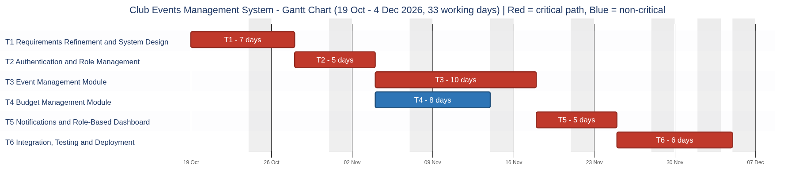

# Gantt Chart

Tool: mermaid.ink (source: [Gantt_Chart.mmd](Gantt_Chart.mmd)). Start date Monday 19 Oct 2026, Mon-Fri working days. Red bars are critical tasks.

| ID | Task | Start | Finish | Days |
|---|---|---|---|---|
| T1 | Requirements Refinement & System Design | Mon 19 Oct 2026 | Tue 27 Oct 2026 | 7 |
| T2 | Authentication & Role Management | Wed 28 Oct 2026 | Tue 03 Nov 2026 | 5 |
| T3 | Event Management Module | Wed 04 Nov 2026 | Tue 17 Nov 2026 | 10 |
| T4 | Budget Management Module | Wed 04 Nov 2026 | Fri 13 Nov 2026 | 8 |
| T5 | Notifications & Role-Based Dashboard | Wed 18 Nov 2026 | Tue 24 Nov 2026 | 5 |
| T6 | Integration, Testing & Deployment | Wed 25 Nov 2026 | Fri 04 Dec 2026 | 6 |

Overall timeline: 19 Oct 2026 - 4 Dec 2026 (33 working days).
