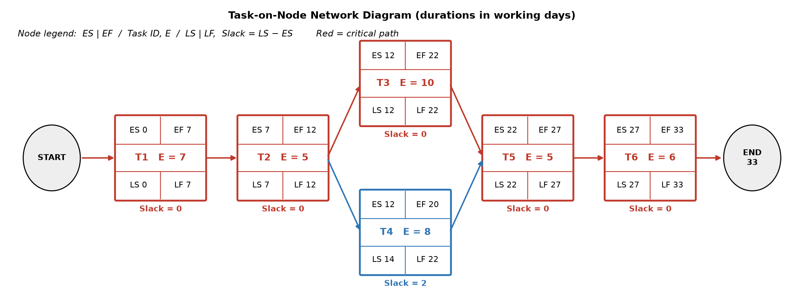

# Network-Based Schedule (Task-on-Node)

## Calculations

Forward pass: ES = max(EF of predecessors), EF = ES + E.
Backward pass: LF = min(LS of successors), LS = LF - E.
Slack = LS - ES.

| Task | E | ES | EF | LF | LS | Slack |
|---|---|---|---|---|---|---|
| T1 | 7 | Project start = 0 | 0+7 = 7 | LS(T2) = 7 | 7-7 = 0 | 0 |
| T2 | 5 | EF(T1) = 7 | 7+5 = 12 | min(LS T3, LS T4) = min(12, 14) = 12 | 12-5 = 7 | 0 |
| T3 | 10 | EF(T2) = 12 | 12+10 = 22 | LS(T5) = 22 | 22-10 = 12 | 0 |
| T4 | 8 | EF(T2) = 12 | 12+8 = 20 | LS(T5) = 22 | 22-8 = 14 | 14-12 = 2 |
| T5 | 5 | max(EF T3, EF T4) = max(22, 20) = 22 | 22+5 = 27 | LS(T6) = 27 | 27-5 = 22 | 0 |
| T6 | 6 | EF(T5) = 27 | 27+6 = 33 | Project end = 33 | 33-6 = 27 | 0 |
